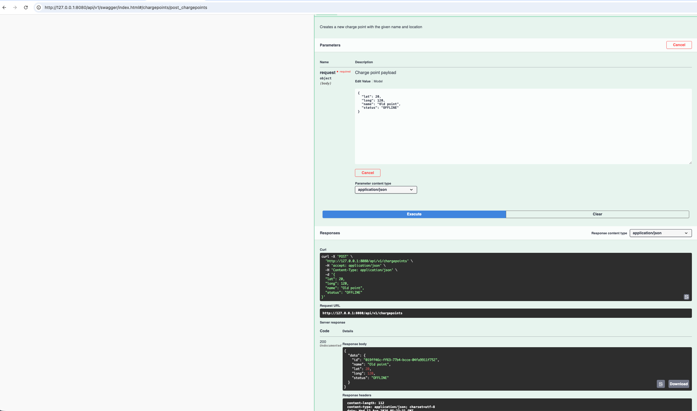
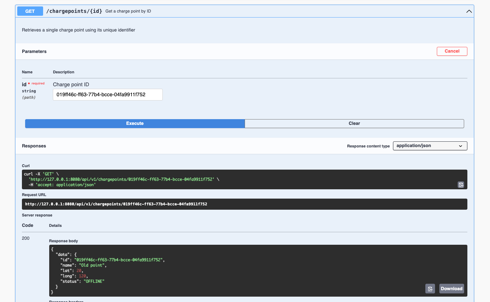

# EV Charge Point API

A RESTful API server in Go for managing and querying a database of Electric Vehicle (EV) charge points.

## Tech Stack

- Go
- Gin
- SQLite
- Project layout follows the [golang-standards/project-layout](https://github.com/golang-standards/project-layout) convention

## Getting Started

### Prerequisites

- Go installed (see `go.mod` for version)

### Running the server

```bash
go run ./cmd/server
```

The server starts on `http://127.0.0.1:8080`. The SQLite database file is created automatically on first run — no additional setup required.

### API documentation (Swagger)

Once the server is running, visit:

[http://127.0.0.1:8080/api/v1/swagger/index.html](http://127.0.0.1:8080/api/v1/swagger/index.html)

To regenerate the docs after changing annotations:

```bash
go tool swag init -g cmd/server/main.go -o api --parseDependency --parseInternal
```

### Running tests

```bash
go test ./...
```

### Regenerating mocks

Mocks are generated with [mockery](https://vektra.github.io/mockery/) and used for unit testing the service layer. Run this after changing an interface signature:

```bash
go tool mockery
```

## API Endpoints

| Method | Endpoint                | Description                                          |
|--------|--------------------------|-------------------------------------------------------|
| POST   | `/chargepoints`          | Create a new charge point                              |
| GET    | `/chargepoints/{id}`     | Get a single charge point by ID                        |
| GET    | `/chargepoints/nearby`   | Find charge points within a radius (km) of a location  |

## Design Decisions & Trade-offs

- **Project structure**: layered into `entities` (shared domain types), `service` (business logic), and `repository` (persistence), each scoped per feature rather than by technical layer. Interfaces exist only where a real need for substitution exists today — e.g. `repository.Repository`, to allow swapping SQLite for Postgres without touching the service or controller layers.
- **IDs**: UUID v7, not an auto-incrementing integer — avoids exposing sequential, enumerable IDs and avoids cross-node ID collisions, while still keeping index-friendly insert locality (unlike UUID v4) thanks to its embedded timestamp prefix.
- **Errors**: repository methods log the underlying error and return generic, transport-agnostic sentinel errors (`internal/pkg/apperrors`) rather than leaking raw storage details upward. The HTTP layer maps these sentinels to status codes at the controller boundary.
- **`/nearby` endpoint**: uses an indexed latitude/longitude bounding box (equirectangular approximation) as a cheap pre-filter, then computes exact distance via the spherical law of cosines (haversine-equivalent) on the narrowed candidate set, ordering and filtering by real distance. This performs well at the scale of this exercise. At much larger scale (millions of rows), I'd move to Postgres with PostGIS and a GiST spatial index, which indexes actual spherical geometry directly rather than relying on a flat-plane approximation combined with two independent B-tree range scans.
- **Config, graceful shutdown, and centralized error middleware** were intentionally left out of scope given the single-run, local-reviewer context this assignment is evaluated in — happy to discuss how each would be added for a real deployment.

## Time Spent

Approximately 6 hours.

## LLM Usage
Collaborated on this assessment and generated this readme with Claude Sonnet.

## Screenshots




